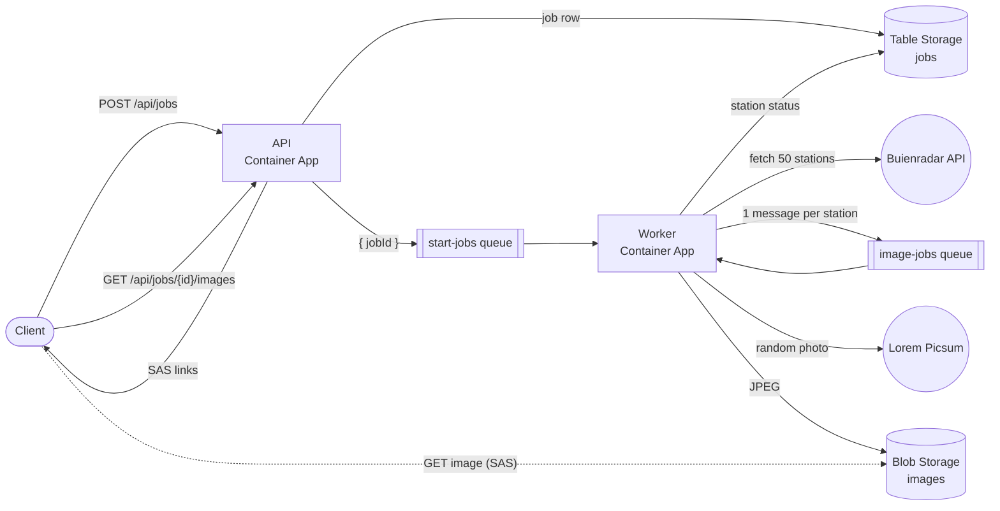

# WeatherApp

An API on Azure Container Apps that generates an image for every Buienradar weather station: a public photo with
the station's current weather drawn on top. A job is started with one HTTP call. The work runs in the background
through Azure Storage Queues, and the finished images are served from Blob Storage via SAS links.

## Architecture



1. `POST /api/jobs` writes a job row to Table Storage, puts a message on the **start-jobs** queue and returns `202`
   with the job id right away.
2. The worker picks up the start message, fetches the Buienradar feed and **fans out**: one message per weather
   station (up to 50) on the **image-jobs** queue.
3. For each station message, the worker fetches a public photo, draws the weather data on it, uploads the JPEG to
   Blob Storage and marks that station as done in the table. When the last station finishes the job becomes
   `completed`.
4. `GET /api/jobs/{id}` shows progress; `GET /api/jobs/{id}/images` returns a read-only SAS link for every image.

The worker reads messages from the queues itself (receive → process → delete). A failed message is retried with
back-off, and after 5 attempts it is moved to a `<queue>-poison` queue and the station (or job) is marked `failed`.
KEDA scales the worker on the length of both queues, down to zero replicas when there's nothing to do.

Job state lives in Table Storage, one partition per job: a summary row plus one row per station. Each worker only
writes its own station's row, so the fan-out never fights over a shared counter, and a redelivered message updates
the same row instead of being counted twice.

## Requirements checklist

| Requirement                                                     | Where                                                        |
| --------------------------------------------------------------- | ------------------------------------------------------------ |
| Public API to request fresh images                              | `POST /api/jobs` ([api/src/routes/jobs.ts](api/src/routes/jobs.ts)) |
| Background processing via queues, fast initial call             | API only enqueues; [worker/](worker/) does the work           |
| Blob Storage stores and exposes the images                      | [shared/src/storage/images.ts](shared/src/storage/images.ts) |
| Queue Storage: create, read and delete messages                 | [worker/src/queueConsumer.ts](worker/src/queueConsumer.ts)   |
| Buienradar API                                                  | [worker/src/services/buienradar.ts](worker/src/services/buienradar.ts) |
| Public image API                                                | Lorem Picsum ([imageSource.ts](worker/src/services/imageSource.ts)) |
| Public API to fetch the generated images                        | `GET /api/jobs/{id}/images`, `GET /api/jobs/{id}/images/{stationId}` |
| Swagger UI                                                      | `/docs` ([api/src/openapi.ts](api/src/openapi.ts))           |
| Bicep template incl. queues                                     | [infra/](infra/)                                             |
| `deploy.sh` using the Azure CLI                                 | [infra/deploy.sh](infra/deploy.sh) (and [deploy.ps1](infra/deploy.ps1) for Windows) |
| Multiple queues (start job + per-image)                         | `start-jobs` and `image-jobs`                                |
| TypeScript                                                      | everything                                                   |
| *Could:* SAS tokens instead of a public container               | container is private, API returns 24h read-only SAS links    |
| *Could:* bearer authentication on the request API               | `POST /api/jobs` requires `Authorization: Bearer <ACCESS_TOKEN>` |
| *Could:* status endpoint, status saved in Table Storage         | `GET /api/jobs/{id}` ([shared/src/storage/jobs.ts](shared/src/storage/jobs.ts)) |

> Buienradar currently reports 40 stations, so a job produces 40 images. The limit is 50 (`STATION_LIMIT`).

## API

| Method | Path                                    | Auth   | Description                                         |
| ------ | --------------------------------------- | ------ | --------------------------------------------------- |
| POST   | `/api/jobs`                             | Bearer | Start a job, returns `202` with `jobId` and links   |
| GET    | `/api/jobs/{jobId}`                     | –      | Status and progress (`queued` → `fetching` → `processing` → `completed`/`failed`) |
| GET    | `/api/jobs/{jobId}/images`              | –      | SAS links to all images generated so far            |
| GET    | `/api/jobs/{jobId}/images/{stationId}`  | –      | Redirects to the image of one station               |
| GET    | `/health`                               | –      | Health check                                        |
| GET    | `/docs`                                 | –      | Swagger UI (`/openapi.json` for the raw spec)       |

Only starting a job requires the token. Job ids are random UUIDs, so status and results are readable by whoever
has the id.

```bash
curl -X POST -H "Authorization: Bearer $ACCESS_TOKEN" https://<app>/api/jobs
curl https://<app>/api/jobs/<jobId>
curl https://<app>/api/jobs/<jobId>/images
```

## Deploying to Azure

Prerequisites: [Azure CLI](https://learn.microsoft.com/cli/azure/install-azure-cli), Docker, and an Azure
subscription you're logged in to (`az login`).

```bash
cp .env.example .env     # adjust APP_NAME / REGION if you like
./infra/deploy.sh
```

On Windows, use the PowerShell version instead (works in Windows PowerShell 5.1 and PowerShell 7):

```powershell
Copy-Item .env.example .env
.\infra\deploy.ps1
```

If PowerShell refuses to run the script because of the execution policy, start it with
`powershell -ExecutionPolicy Bypass -File .\infra\deploy.ps1`.

Both scripts do the same thing:

1. registers the needed resource providers and creates the resource group `APP_NAME`;
2. deploys [infra/main.bicep](infra/main.bicep) with `deployApps=false`: storage account (blob container, both
   queues + poison queues, table), container registry with a pull identity, Log Analytics and the Container Apps
   environment;
3. builds the `api` and `worker` images and pushes them to the registry with a unique tag;
4. deploys the template again with `deployApps=true`, which creates or updates both container apps with the new
   images;
5. prints the API URL, the Swagger URL and the access token.

If `ACCESS_TOKEN` is empty, the script generates one and saves it in `.env`. Running the script again redeploys
the current code. Set `USE_ACR_BUILD=true` to build the images in Azure instead of with local Docker (not available
on Azure for Students subscriptions).

To remove everything: `az group delete --name <APP_NAME>`.

## Local development

`docker compose up --build` runs the API, the worker and [Azurite](https://github.com/Azure/Azurite) (local Azure
Storage). The API is at http://localhost:3000/docs and image links point to Azurite on `localhost:10000`.
Put `ACCESS_TOKEN` in `.env` to require the bearer token locally as well.

Without Docker for the apps (the repository is a [pnpm](https://pnpm.io) workspace):

```bash
pnpm install
docker compose up -d azurite
pnpm --filter @weatherapp/shared build
pnpm --filter @weatherapp/api dev      # and in another terminal:
pnpm --filter @weatherapp/worker dev
```

`pnpm typecheck` and `pnpm lint` check the whole repository. After changing code in `shared/`, rebuild it with
`pnpm --filter @weatherapp/shared build` so the API and worker pick up the change.

## Project structure

```
api/        Express API: routes, bearer auth, OpenAPI spec + Swagger UI
worker/     Queue consumers: start job (Buienradar fan-out) and image job (photo + weather overlay)
shared/     Config, logger, and Storage access (queues, blobs, job table) used by both
infra/      Bicep templates (main.bicep + one module per resource), deploy.sh and deploy.ps1
```
